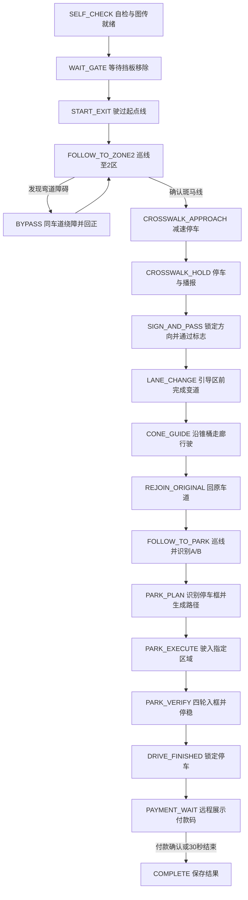

# 室外 5G 无人车比赛状态机设计

设计日期：2026-10-17。本文是针对当前程序的设计方案，尚未实现完整比赛控制器。

依据：用户提供的《第二十届全国大学生智能汽车竞赛——室外5G远程驾驶无人车赛比赛规则》，2025 年 7 月，共 14 页。
[原始 PDF](</mnt/c/Users/JamieK/Documents/2-智能汽车比赛-赛项二/0-官方资料/赛项二-室外5G远程驾驶无人车赛比赛规则.pdf>)。
以下页码为 PDF 页码；规则要求与工程建议分别注明，不把仿真布局当成比赛规则。

## 1. 系统结构

采用分层任务状态机，保留现有地面车道识别和 Pure Pursuit 控制能力：

```text
相机 / 相机内参 / 编码器与 IMU 位姿估计
                 ↓
感知：车道、挡板、锥桶、斑马线、箭头、A/B、停车框
                 ↓
比赛任务状态机：选择目标车道、目标走廊、停车目标和速度上限
                 ↓
局部路径生成：车道中心 / 同道绕障 / 变道 / 锥桶走廊 / 入框
                 ↓
Pure Pursuit + 速度与制动控制
                 ↓
唯一指令出口：/ackermann_cmd
```

故障监督器独立监测数据新鲜度、路径可行性和停车时长，优先覆盖任务运动指令。
5G 图传和语音播报异步运行，不在控制循环里阻塞等待网络或播放完成。
比赛中车端本地自主决策；远端接收画面、状态和停车付款视图，不远程指定车辆转向。

当前 `b1_lane_follow.py` 同时完成图像处理和指令发布，接入状态机前应将感知输出、路径目标和最终指令出口分离。
不能让多个巡线、避障或停车节点同时直接发布到 `/ackermann_cmd`。

## 2. 比赛主流程



各运动状态均可被 `RECOVERY_HOLD` / `E_STOP` 抢占，图中省略这些重复连线。
避障是巡线阶段内部的子任务，不按固定里程或固定秒数强行执行。

## 3. 状态定义与转换条件

| 状态 | 进入后执行 | 正常退出条件 | 失败或不确定时 |
|---|---|---|---|
| `SELF_CHECK` | 保持零速；检查图像、内参、定位/里程计、执行器、图传；加载学校和队名；清空本轮识别缓存 | 数据新鲜、配置完整、赛前已布防、已确认看到挡板 | 保持未布防，给出具体缺项 |
| `WAIT_GATE` | 保持零速，跟踪大块蓝色挡板及前方可通行区域 | 先看到挡板，再连续确认挡板移除且前方路径安全 | 挡板检测丢失不直接等同于已移除 |
| `START_EXIT` | 低速沿当前车道前进 | 前轮越过起点黄线，记录本车估计的起跑时刻 | 起点未定位时继续受控低速观察；实际计时以裁判为准 |
| `FOLLOW_TO_ZONE2` | 使用现有视觉车道跟踪；检测单个障碍和斑马线 | 障碍事件触发绕障子状态；斑马线事件触发停车流程 | 未见某个道具不按预设坐标伪造任务完成 |
| `OBSTACLE_PLAN` | 估计锥桶位置，计算同一车道内左右可通行空间，生成有车辆宽度约束的绕行路径 | 一侧存在足够间隙且曲率、制动与边界约束满足 | 先减速；确实无路则停车，不压线硬绕 |
| `OBSTACLE_PASS` | 低速跟踪绕行路径，持续更新锥桶相对位置和车道边界 | 整车尾部已越过目标锥桶并留有距离裕量 | 目标短暂不可见时用跟踪估计；估计过期转故障保持 |
| `OBSTACLE_REJOIN` | 平滑回到原车道中心 | 横向和航向误差稳定落入阈值，锁存该障碍已通过 | 仍有偏差则继续修正，不只按定时器结束 |
| `CROSSWALK_APPROACH` | 把条纹边缘投影到地面，按车头位置计算停车点并提前制动 | 实测近零速，车头在横道前且距离小于 0.30m | 停车位置不符合时只在有余量时低速修正；不盲目前冲 |
| `CROSSWALK_HOLD` | 保持零速；从真正停稳开始计时；异步播报学校、队名和规定内容；可同时观察后方箭头 | 连续停满配置时长，语音任务已结束或已报告明确失败 | 语音故障记录事件，有限重试；不能为等语音无限停车 |
| `SIGN_AND_PASS` | 从本轮新图像确认左/右箭头，锁存方向；保持当前车道低速驶过横道和标志 | 方向可靠、横道已通过、标志已按赛前确认的车辆参考点通过、前方具备变道空间 | 未可靠识别则继续在允许观察距离内采样，不能随机选边 |
| `LANE_CHANGE` | 按箭头生成通往相邻车道的平滑路径；检测引导锥桶入口 | 在引导区入口前横向位置和航向已稳定到目标车道 | 到入口仍未完成就停车/失败处置，不冲入锥桶 |
| `CONE_GUIDE` | 依据内侧红/蓝锥桶与外侧黄色锥桶生成可行驶走廊，跟踪走廊中线 | 锥桶通道引导车辆靠近原比赛车道出口 | 只剩一侧边界时可做短时预测，不能永久以固定宽度补另一侧 |
| `REJOIN_ORIGINAL` | 融合锥桶末端与白线，恢复原比赛车道语义 ID | 原车道边界、横向位置、航向连续满足确认条件 | 不因最近的一对白线看起来居中就提前宣告回归 |
| `FOLLOW_TO_PARK` | 正常巡线，检测本轮 A/B 标志、停车黄色边框 | A/B 已可靠锁存且看见停车框几何 | A/B 随机重新识别，不能继承上一轮结果 |
| `PARK_PLAN` | 建立行驶方向坐标系：A 在左、B 在右；生成低速入框路径和停车位姿 | 路径可行，末端四个轮胎接触区域均有入框余量 | 停车框置信度不足时减速观察，不能只看车辆中心 |
| `PARK_EXECUTE` | 极低速跟踪停车路径，考虑制动距离避免冲出框 | 选定框内首次出现四轮全部进入的观测，立即进入停车确认 | 剩余空间不足时停止，不用大转角高速纠偏 |
| `PARK_VERIFY` | 零速保持，连续确认四轮在指定框内；保存首次四轮入框时刻和确认时刻 | 全部轮胎区域入框且停稳 | 仍可安全修正时有限修正；否则记录停车未达标，不伪造成功 |
| `DRIVE_FINISHED` | 锁定零速，保存驾驶结果；对准/展示该停车位付款码 | 开始付款展示阶段 | 不恢复巡线，不执行回到起点 |
| `PAYMENT_WAIT` | 保持停车和 5G 图传，显示 30s 倒计时，由队员远程微信支付 0.01 元并展示结果 | 人工确认支付结果或 30s 到期 | 未支付记录为付款加分项未完成，不重新启动车辆 |
| `COMPLETE` | 保持零速，保存视频与任务记录 | 本轮结束 | 只允许赛后重新布防 |

车头到横道的距离必须考虑相机、后轴、前轴及车头的坐标偏移，不能拿相机到横道距离直接作为车头距离。
文档未明确“经过变道标志”的车辆参考点，需赛前确认；实现用显式可配置的通过事件，而不是看到箭头就立刻变道。

## 4. 模块输出与路径控制

感知模块统一输出带 `stamp`、置信度、几何位置及目标 ID 的观测：

- `lane_observation`：两侧边界、中心线、宽度、曲率与置信度；普通段允许直道，重叠处支持弧线偏好。
- `gate_observation`：挡板是否看见/是否仍存在、前方空闲证据；不能仅用“蓝色像素减少”决定发车。
- `cone_observations`：位置、颜色、跟踪 ID；结合比赛阶段区分单个障碍和引导锥桶。
- `crosswalk_observation`：多条横向条纹、横道边缘、车头距离；与纵向白线分开。
- `direction_sign` / `parking_sign`：本轮左/右、A/B，多帧一致后锁存。
- `parking_observation`：目标框多边形、车轮接触区域相对位置和入框置信度。

任务状态机输出 `path_mode`、`target_path`、`speed_limit`、`stop_request`，不自己反复发布固定舵角：

| path_mode | 路径来源 | 速度初始建议（非规则） |
|---|---|---|
| `LANE_CENTER` | 视觉车道中心 | 目标 0.7m/s，按路径置信度和曲率限速 |
| `IN_LANE_BYPASS` | 原车道内绕障曲线 | 0.20～0.35m/s |
| `CHANGE_LANE` | 从当前车道到相邻车道的平滑曲线 | 0.20～0.30m/s |
| `CONE_CORRIDOR` | 两侧引导锥桶生成的走廊中线 | 0.20～0.30m/s |
| `PARK_PATH` | 指定停车框的低速入框路径 | 0.10～0.15m/s |
| `HOLD` | 无运动路径 | 0 |

绕障和变道可先采用五次横向过渡：`d(u)=D*(10u^3-15u^4+6u^5)`，其中 `u` 为沿路进度的归一化值。
完成判据使用观测位姿和路径进度，不以“打舵几秒”代替；生成后还要检查整车扫掠范围、锥桶间隙和可实现曲率。
Pure Pursuit 可继续复用，速度需随接近障碍、横道、锥桶和停车框而变化，不能全赛程固定 0.7m/s。

正常巡线和同道绕障保持车轮在车道内；标志要求的变道需要通过特定分界线，状态机应显式区分正常边界和变道目标边界。
PDF 同时规定变道与“任意位置压跑道线罚时”，变道过程的判罚边界应向裁判确认，本文不自行声明一律豁免。

## 5. 事件锁存与恢复

每次布防清空以下本轮上下文，不能复用上一轮随机标志：

```text
run_id, phase, original_lane_reference, target_lane
gate_seen, start_line_crossed
obstacle_track_id, obstacle_passed
crosswalk_track_id, crosswalk_serviced
turn_direction, sign_passed
guide_entered, original_lane_rejoined
parking_target, first_four_wheels_inside_at, parking_confirmed
speech_started, speech_finished, payment_confirmed
```

普通视觉事件初始可用“连续 3～5 帧一致”确认；对于缓慢变化、低帧率和短暂遮挡，可改为带时间窗口的置信度累计。
斑马线、标志和障碍用目标 ID、几何位置与离开事件消抖：同一横道不会在停车后再次触发 10s 等待。
原车道用语义参考和相对运动保持身份，变道和锥桶区域禁止白线模块擅自把车辆拉回旧中心线。

故障监督器优先级：`E_STOP > ABORTED / FAULT_HOLD > 任务控制`。

- 数据过期、车道/走廊不可靠、路径不可行：先发送零速，进入 `RECOVERY_HOLD`，保存任务检查点。
- 恢复必须重新确认同一任务目标、当前位置和所需观测；停车计时状态不会被一般“视觉恢复”事件提前结束。
- 无新观测时不得只靠上一条预测路径无限继续，也不得因计时快超限而强行前进。
- 途中连续停车时长由独立计时器监测，切换子状态不清零；工程上建议在 15s 内决定继续或终止，避免撞上规则的超过 20s 失败阈值。
- 偏离正确车道设置更短的恢复预算，例如 3s；超过预算仍无法可靠回归则保持停车并锁存失败，不冒险硬开。
- 正常 10s 横道等待也纳入途中停车总时长管理；赛前未发车与已确认驾驶结束后的付款阶段按不同生命周期管理。
- `ABORTED` / `E_STOP` 不自动回起点，需赛后解除并重新布防。人为干预按规则可能产生判罚，软件不能宣称紧急干预免罚。

上述 3s、15s、视觉帧数与速度是工程初值，需通过测试调整；规则的 10s 停车/20s 超时等另列来源。

## 6. 停车、二维码、付款与训练配置

停车成功依据为所选 A/B 框内四轮进入（第 3、11 页），车辆质心进入不能代替。
规划时用保守的轮胎接触矩形和内缩后的停车多边形；实车依据标定几何与视觉/定位估计，仿真验收才读取 Gazebo 四轮真值。
记录首次入框观测用于估计结束时刻，再做稳定性确认，实际成绩仍以裁判为准。

付款由参赛队员远程微信完成（第 9 页），系统提供停车位付款码的可读画面和倒计时。
不设计无人车自动付款，也不将仿真字符串二维码识别成功当作微信付款完成。
第 4 页规定了区域 2 后二维码的外观和摆放，但没有清楚规定该码的强制自主识别动作；不凭空添加必经的 `SCAN_QR_ZONE2` 状态。
其支架仍作为需要感知和避碰的物体，不能因任务语义不明确就忽略碰撞。

建立两种运行配置：

- `practice`：允许人工重置和 `--reset-on-exit`，用于重复调试；这些操作不算比赛动作。
- `competition`：关闭 Gazebo 位姿复位与自动回起点；停车后保持车位，供远程付款和裁判确认。

当前无限连续等待的调试模式不能直接充当比赛故障策略；正式模式需要上面的有界恢复和失败状态。
当前仿真 `/odom` 使用 Gazebo 真值，实车应接入编码器/IMU 等位姿估计；不得把仿真精度当作实车已具备的能力。

## 7. 规则依据与需要确认的口径

| 项目 | 文档依据 | 设计处理 |
|---|---|---|
| 比赛前实时画面经 5G 回传，运行中避免人工遥控 | 第 2、7 页 | 发车前图传就绪门槛，运行时本地自主决策 |
| 移除蓝挡板自主发车，前轮过起点线计时 | 第 2、4、7 页 | 门控发车和起点线事件分开 |
| 弯道单个障碍，左右均可绕，不能压线/出界 | 第 5、7 页 | 同道可行空间规划，不把绕障当变道 |
| 横道前车头距离小于 30cm | 第 5、8 页 | 建议停车目标 0.15～0.25m，属于工程留量 |
| 横道停车时长冲突 | 第 5 页写 3s，第 2、7 页写 10s | 暂定 `crosswalk_hold_s=10`，赛前确认后配置，不在代码写死 |
| 规定学校/队名语音，漏播或错播有罚时 | 第 7、10 页 | 停车时异步播报并记录完成反馈 |
| 箭头每次随机，过标志后、引导区前完成变道 | 第 6、8 页 | 本轮识别与通过事件分开，入口前完成姿态收敛 |
| 沿引导锥桶路线回到原车道 | 第 8～10 页，图 11 | 独立锥桶走廊状态与原车道回归确认 |
| A/B 每次随机；A 为行进方向左，B 为右 | 第 9 页 | 以车辆行进方向解释，左右起点不互换字母含义 |
| 四轮入框；30s 内远程支付 0.01 元，额外 5 分 | 第 3、9、11 页 | 驾驶结束和付款结果分开保存，付款不成功不凭空重启驾驶 |
| 锥桶触碰 20s；拖行超过 2m 失败 | 第 10 页 | 路径扫掠间隙与疑似接触监测，不能拖着障碍继续 |
| 压线 10s/次，偏离 20s，偏离超过 10s 未回归失败 | 第 10 页 | 边界约束和短恢复预算；变道跨线口径需另确认 |
| 途中停车超过 20s 失败；人工干预 100s/次 | 第 10、11 页 | 有界恢复，调试复位与正式比赛隔离 |

赛前需明确：横道 3s/10s 冲突、规定变道跨白线的判罚口径、通过箭头的参考点、区域 2 二维码的实际用途，以及现场补充规则。
本文严格以用户给出的版本为设计依据，没有宣称这是当前赛事最新版本。

## 8. 建议实施顺序与验收

1. 先提取巡线感知与路径控制接口，建立唯一指令出口和状态日志。
2. 完成挡板起跑 → 巡线 → 横道精确停车 → 10s 语音 → 继续巡线。重点验收时序、车头距离和横道不重复触发。
3. 完成弯道同道绕障；改变障碍随机位置，检查轮胎压线和锥桶接触。
4. 完成随机左右箭头 → 通过标志 → 相邻车道变道 → 锥桶走廊 → 原车道回归。
5. 完成随机 A/B → 四轮入框 → 驾驶结束 → 图传付款展示。付款留人工确认接口。
6. 在红/蓝底、左/右起点、左/右箭头、A/B 停车的 16 种组合上回归，再更换障碍与标志随机种子。

失败注入至少包含：挡板未移除、相机短断流、标志一帧误识别、语音失败、锥桶遮挡、车身中心进框但车轮出框、停车目标错选、恢复超过预算。
记录每次 `from_state, to_state, reason, stamp, perception_confidence, target_id, speed_command, task_result`，并保留转换前后视频。
`layout.json` 和 Gazebo 真值只给验收工具使用，不向任务状态机泄露本轮箭头、停车字母或障碍位置。

目前仅现有巡线重叠弯道段完成 25m 仿真验证；本文列出的起跑、完整避障、变道、引导、停车与付款状态尚未实现或端到端验收。
