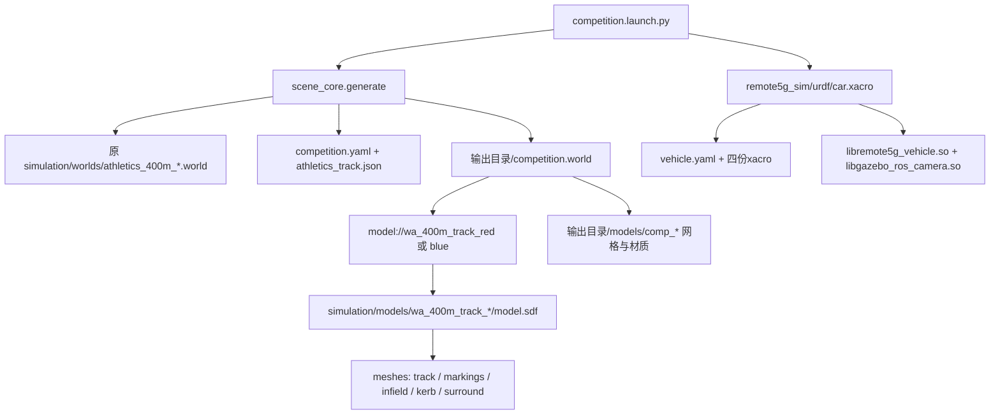

# 02 工程结构、包与资源

配置已于2026-10-15更新：前置30fps，速度/转角目标及反馈50Hz，drive.py定时50Hz，RSP上限50Hz；云台仍15fps。当前实测见 [频率修订报告](FREQUENCY_UPDATE_20261015.md)。未标修订的原始运行日志属于此前20Hz/15fps调查，不能当当前频率证据。

主根目录 `/home/jamiek/remote5g_ws`，不是home目录下任意其他仓库。源码包清单经 `colcon list`复核只有两个。未在本工程及父级发现适用AGENTS.md。

## 精简目录树

完整受控树见 [project_tree.txt](snapshot/project_tree.txt)。省略构建缓存和重复资源内容：

```text
remote5g_ws/
├── src/
│   ├── remote5g_sim/
│   │   ├── package.xml, CMakeLists.txt, README.md
│   │   ├── urdf/{car,common,wheels,cameras}.xacro
│   │   ├── config/{vehicle,parameter_sources,hardware_reference_NOT_LOADED}.yaml
│   │   ├── src/{vehicle_plugin,gui_capture}.cpp
│   │   ├── include/remote5g_sim/control_math.hpp
│   │   ├── launch/sim.launch.py
│   │   ├── worlds/flat.world
│   │   ├── scripts/{drive,inspect_cameras}.py
│   │   ├── test/（control_math_test.cpp, model_check.py, regression.py, smoke.py）
│   │   └── docs/REFERENCE_REVIEW.md, reference_manifest.json
│   └── remote5g_competition/
│       ├── package.xml, CMakeLists.txt, README.md
│       ├── config/competition.yaml, layout_left.yaml, layout_right.yaml, parameter_sources.yaml
│       ├── launch/competition.launch.py
│       ├── scripts/{scene_core,generate_layout,validate_layout,manage_props,parking_check}.py
│       ├── models/comp_*/（19种独立SDF及网格/材质）
│       ├── materials/source_signs/（PDF嵌入标志位图）
│       ├── worlds/{left,right}_{red,blue}/（派生world/清单/资源）
│       ├── test/（几何、实际Gazebo、CLI、矩阵与报告工具）
│       └── docs/（尺寸、场景、规则素材溯源和验收）
├── config/athletics_track.json
├── simulation/{models,worlds,maps}/
├── scripts/{generate_athletics_tracks.py,launch_track.sh,test_xtnetrc.sh,lib/}
├── docs/{official,notes,GAZEBO_TEST_REPORT.md,chatgpt_handoff/}
├── reports/{xtnetrc,competition}/
├── artifacts/, deliverables/（历史图片及分发归档）
├── data/（预留）
└── build/, install/, log/（生成物）
```

树中 `.py`后缀组合只作简写，`control_math_test.cpp`确为C++，不存在同名Python文件。当前没有setup.py/setup.cfg的Python包，两包都是ament_cmake。

## 两个包及关系

| 包 | 功能与主要依赖 | 入口/产物 |
|---|---|---|
| remote5g_sim 0.1.0 | Gazebo ModelPlugin、机器人结构、双相机、关节状态/里程计、操作与回归。依赖gazebo_ros/gazebo_plugins、rclcpp/rclpy、ackermann_msgs、geometry/nav/sensor/std/diagnostic_msgs、tf2_ros、xacro、RSP、Qt5 | sim.launch.py；libremote5g_vehicle.so；drive.py、inspect_cameras.py与测试脚本 |
| remote5g_competition 0.1.0 | 独立比赛道具、跑道局部坐标、随机种子、几何/停车检查。运行依赖remote5g_sim与gazebo_ros、ROS消息、numpy/opencv/yaml/PIL/qrcode及已有zxing缓存 | competition.launch.py；生成overlay world；manage_props.py、parking_check.py、validate_layout.py、run_matrix.py |

精确依赖分类（buildtool/build/exec）见 [packages.json](snapshot/packages.json)。competition复用sim模型，sim不依赖competition；两个包都读取现有轨道资源，没有把轨道重建成另一套坐标。

## 重要文件定位

- `remote5g_sim/config/vehicle.yaml`：机械/质量/摩擦/控制/相机参数；默认配置事实源。
- `urdf/car.xacro`：模型组装与插件参数；其余三个xacro分别是通用盒惯性/固定连接、轮胎转向、相机云台宏。
- `src/vehicle_plugin.cpp`：真实控制回调、限幅、租约、PD/P与实际反馈；不是视觉算法。
- `include/.../control_math.hpp`：阿克曼角、Twist转换和速度变化率；可独立单测。
- `sim.launch.py`：flat/red/blue三种车辆场景；config参数指车辆YAML。
- `competition.launch.py`：生成道具world、插入同一车；config参数指**比赛YAML**，含camera_width/height，不能混用两入口的config含义。
- `competition/scripts/scene_core.py`：读取轨道几何、Route.pose(s,d)、资源生成、四排引导、随机单障碍、四轮停车几何、QR验证。
- `config/athletics_track.json` + `scripts/generate_athletics_tracks.py`：既有轨道参数与生成源码。调查中只读，没有重新生成。
- `simulation/maps/lane_*_centerline.csv`：名义车道参考线；存在不代表已有路径跟踪器使用。
- `scripts/launch_track.sh`：只开原跑道，**不会自动插车或建立完整ROS车辆接口**。
- `test/*`：测试可临时发布控制或移动夹具；不是常驻比赛算法。
- `hardware_reference_NOT_LOADED.yaml`：实车PWM说明数据，不被launch/plugin读取。本次副本不包含该无关硬件参数文件。

## 资源引用链



小型world/SDF引用已放入snapshot/source；[resources.json](snapshot/resources.json)列出803条资源路径/字节数/URI/插件，数量含派生场景副本，不代表803个不同模型。DAE/PNG等大资源只列清单，不复制进轻量交接包。现有生成SDF可能含绝对file URI，跨机器需重新由launch生成，不直接移动旧world后假设能运行。预生成worlds中的旧vehicle_config及初始审计输出是生成当时的快照，当前运行参数以vehicle.yaml与新launch展开结果为准。

## 文档和测试证据的优先级

源码/配置与本次命令证据优先；历史README和验收只补充背景。根README初始曾有“尚未添加车辆代码或ROS包”的过时描述，本次GitHub发布整理已更新为当前两包、启动及频率说明。`src/remote5g_sim/docs/REFERENCE_REVIEW.md`确实引用stupid_car固定commit及工程外只读缓存，因此仅将其列为几何/默认值参考，**当前项目不是stupid_car，也没有实车控制后端**。

交接源文件副本曾被colcon递归发现为重复包，已在本目录加入 `COLCON_IGNORE` 隔离，并复查只剩原src两包；不改任何原构建文件。保留该标记，不要删除后再从工作区根构建。
