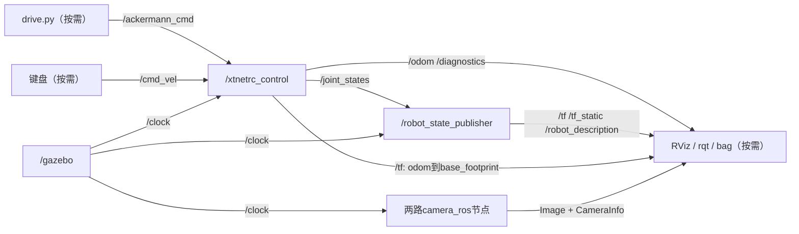
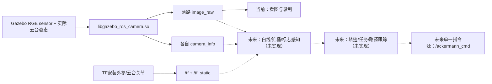
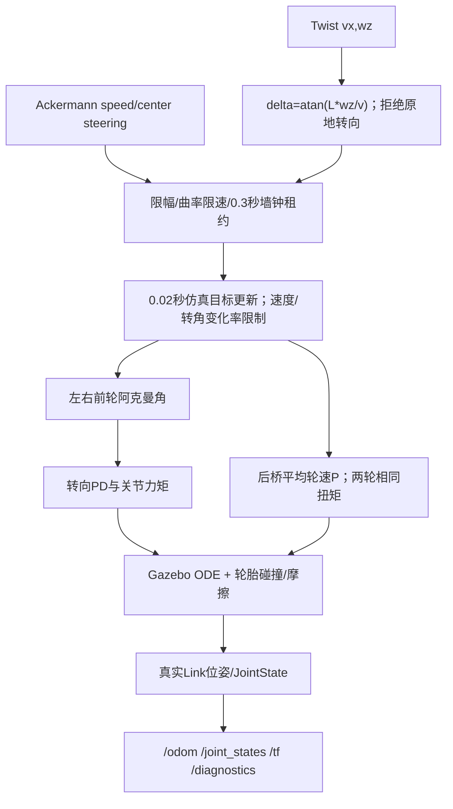
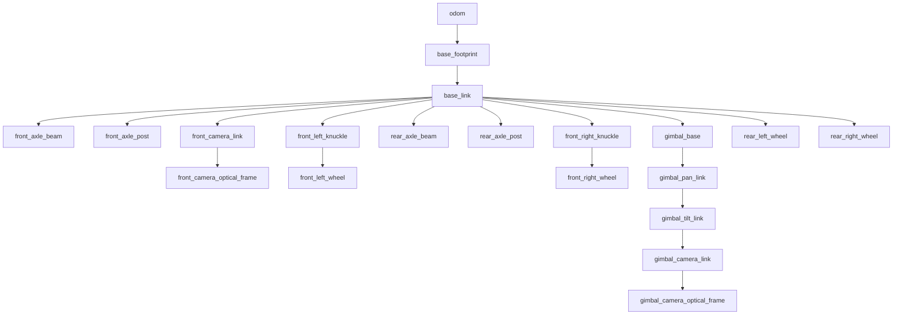
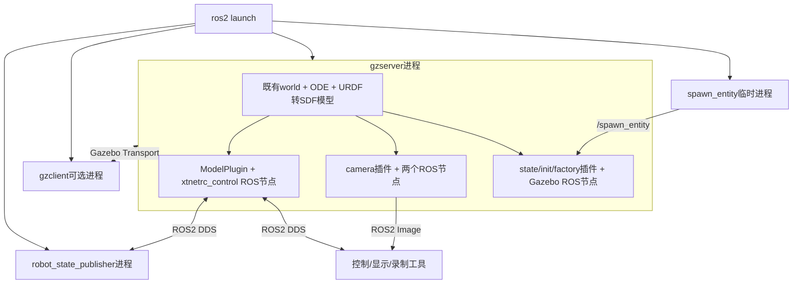

# 04 ROS节点、通信接口与架构图

配置已于2026-10-15更新：前置30fps，速度/转角目标及反馈50Hz，drive.py定时50Hz，RSP上限50Hz；云台仍15fps。当前实测见 [频率修订报告](FREQUENCY_UPDATE_20261015.md)。未标修订的原始运行日志属于此前20Hz/15fps调查，不能当当前频率证据。

依据：[比赛运行图](snapshot/runtime/competition/runtime.json)、[平坦运行图](snapshot/runtime/flat/runtime.json)、[节点列表](snapshot/evidence/node_list.txt)、[服务列表](snapshot/evidence/service_list.txt)、源码副本。相对源码路径均相对 `/home/jamiek/remote5g_ws`。观察节点、ros2 CLI daemon和GUI工具不是车辆生产架构。

## 常驻节点统一清单

| 节点名称 | 所属包/源码或插件 | 功能 | 输入 | 输出 | 参数来源 | 启动入口 | 状态 |
|---|---|---|---|---|---|---|---|
| /xtnetrc_control | remote5g_sim；src/remote5g_sim/src/vehicle_plugin.cpp；libremote5g_vehicle.so | 限幅、看门狗、真实关节执行、反馈 | /ackermann_cmd、/cmd_vel、/gimbal/pan_cmd、/gimbal/tilt_cmd、/clock | /odom、/joint_states、/diagnostics、/tf | vehicle.yaml→Xacro→SDF；ROS use_sim_time=true | 两个launch随模型加载 | [V] |
| /robot_state_publisher | 系统robot_state_publisher；两个launch定义 | 将实际JointState与URDF转换为TF | /joint_states、/clock；robot_description参数 | /tf、/tf_static、/robot_description | use_sim_time=true、publish_frequency=50、URDF | 两个launch中的Node | [V] |
| /camera/front/front_camera_ros | 系统gazebo_plugins；cameras.xacro；libgazebo_ros_camera.so | 固定RGB渲染与针孔信息 | Gazebo camera sensor、/clock | /camera/front/image_raw、/camera/front/camera_info及传输插件广告 | front尺寸、HFOV、rate、光学帧，SDF | 随模型加载 | [V] |
| /camera/gimbal/gimbal_camera_ros | 同上，云台camera sensor | 云台RGB与独立内参 | 云台实际姿态、/clock | /camera/gimbal/image_raw、/camera/gimbal/camera_info及传输广告 | gimbal相机配置 | 随模型加载 | [V] |
| /gazebo | gazebo_ros；libgazebo_ros_init.so + factory | 仿真时间、插删模型、物理服务 | Gazebo更新、模型服务调用 | /clock、/performance_metrics、日志 | 系统插件参数与world | gzserver -s ... | [V] |
| /gazebo/competition_state | gazebo_ros；libgazebo_ros_state.so | 模型/Link真实状态与查询服务 | Gazebo状态 | /gazebo/model_states、/gazebo/link_states；get/set_entity_state服务 | update_rate=20，生成world插件 | competition world | [V] |

平坦场把最后一项替换成 `/gazebo/gazebo_state`，功能相近。两个相机插件、车辆控制、状态插件都是gzserver进程中的ROS节点；不要按“节点=独立进程”去寻找不存在的exe。

## 按需节点与离线工具

| 名称/工具 | 功能与入口 | 本次状态 |
|---|---|---|
| /spawn_entity | gazebo_ros spawn_entity.py；订阅robot_description后调用/spawn_entity | [V] 插入xtnetrc成功后退出，正常现象 |
| /xtnetrc_command_source | remote5g_sim/scripts/drive.py；只发布/ackermann_cmd | [V] 低速有限时长调用 |
| /teleop_twist_keyboard | 已装系统包teleop_twist_keyboard；只发布/cmd_vel | [V] PTY真实按键与运动验证，无本工程专用启动脚本 |
| /xtnetrc_camera_check | remote5g_sim/scripts/inspect_cameras.py；订阅Image/Info并保存PNG | [S/H] 脚本与历史成功记录；本次用独立观察程序采图 |
| /competition_prop_manager | manage_props.py；get/delete/spawn实体 | [S/H] 本次不增删道具 |
| /competition_parking_check | parking_check.py；读取真实四轮Link状态后做几何判定 | [S/H] 不代表自动泊车 |
| /xtnetrc_regression、/competition_integration、/competition_cli_verify | test/中的测试夹具，可能主动发控制/改变仿真实体 | [S/H] 本次没有运行整套回归 |
| generate_layout.py / validate_layout.py / scene_core.py | 生成器、离线校验与库；不是常驻视觉/规划节点 | [S] 比赛launch实际调用其中生成与校验函数 |
| GUI截图插件 | 两个包src/gui_capture.cpp；gzclient截图，不是控制节点 | [V] 本次比赛场景8张截图 |

## 关键Topic字典

| Topic | 消息类型 | 发布者→使用者 | 单位/时间/帧 | 状态 |
|---|---|---|---|---|
| /ackermann_cmd | ackermann_msgs/msg/AckermannDriveStamped | drive或未来单一控制源→xtnetrc_control | speed m/s，中心转角rad；接收墙钟租约 | [V] 控制运动 |
| /cmd_vel | geometry_msgs/msg/Twist | 键盘→xtnetrc_control | vx m/s、wz rad/s；非差速车 | [V] 控制运动 |
| /odom | nav_msgs/msg/Odometry | xtnetrc_control→显示/录制/未来算法 | pose在odom，twist在base_footprint；仿真stamp | [V] 真值、目标约50Hz仿真时间 |
| /joint_states | sensor_msgs/msg/JointState | xtnetrc_control→robot_state_publisher | 8关节rad、rad/s、N·m | [V] |
| /diagnostics | diagnostic_msgs/msg/DiagnosticArray | xtnetrc_control→日志/检查工具 | 状态active/command_timeout等，目标、后轮扭矩、lease_age_s | [V] |
| /camera/front/image_raw | sensor_msgs/msg/Image | 前相机→显示/记录/未来视觉节点 | rgb8，front_camera_optical_frame，默认640或比赛1280模式 | [V] |
| /camera/front/camera_info | sensor_msgs/msg/CameraInfo | 前相机→未来投影/显示 | 与同相机图像尺寸/光学帧匹配 | [V] |
| /camera/gimbal/image_raw、/camera/gimbal/camera_info | Image / CameraInfo | 云台相机→显示/未来目标识别 | gimbal_camera_optical_frame；独立K/实际TF | [V] |
| /gimbal/pan_cmd、/gimbal/tilt_cmd | std_msgs/msg/Float64 | 手动或未来任务节点→车辆插件 | 弧度绝对目标，正Pan左看/正Tilt抬头 | [S/H] 本次回中服务成功 |
| /tf | tf2_msgs/msg/TFMessage | 插件+RSP→RViz/未来算法 | odom→footprint及活动关节 | [V] |
| /tf_static | tf2_msgs/msg/TFMessage | RSP→TF消费者 | 固定安装变换，TRANSIENT_LOCAL | [V] |
| /robot_description | std_msgs/msg/String | RSP→spawn/RViz | 展开URDF，TRANSIENT_LOCAL | [V] |
| /clock | rosgraph_msgs/msg/Clock | /gazebo→use_sim_time节点 | 仿真时间；BEST_EFFORT | [V] |
| /gazebo/model_states、/gazebo/link_states | gazebo_msgs/msg/ModelStates / LinkStates | 状态插件→检查工具 | 仿真模型/Link世界状态 | [V] 实体查询成功，广告列表存在 |

不存在活跃命令源时，`/ackermann_cmd`和`/cmd_vel`仍可因订阅者而列在topic list里；看见话题名不等于有指令。查看 `ros2 topic info ... --verbose` 区分发布者和订阅者。完整传输话题/参数事件/日志也在runtime.json，避免把compressedDepth广告误认成深度数据。

相机raw实测RELIABLE/VOLATILE，clock BEST_EFFORT/VOLATILE，tf_static与robot_description为TRANSIENT_LOCAL。采集里的depth=0可能是RMW端点报告值，不能据此声称发送缓存为0。可靠性/持久性优先以本次verbose及源码为准。

## Service、Action与参数

- [V] `/gimbal/center`，std_srvs/srv/Trigger；调用成功，设置云台目标0，不瞬间改位姿。
- [V] `/gazebo/get_entity_state`、`/gazebo/set_entity_state`，gazebo_msgs/srv/GetEntityState、SetEntityState；本次只调用get查询xtnetrc。
- [V/S] `/spawn_entity`、`/delete_entity`、`/get_model_list`；插车流程调用spawn，调查中不删除模型。
- [V/S] `/pause_physics`、`/unpause_physics`、`/reset_world`、`/reset_simulation`为Empty服务；列表存在，本次未调用reset。
- [V/S] `/camera/front/set_camera_info`和gimbal对应服务存在；未改标定。
- [V] `ros2 action list -t`为空，本场景未发现Action server；未发现controller_manager。
- [V] `/xtnetrc_control`的ROS参数dump只有use_sim_time、QoS覆盖等；机械/速度/转向P值来自SDF `p_` map，**没有ROS参数更新回调**。rqt_reconfigure不能当作实时底盘调参器。
- [V] RSP的use_sim_time=true、publish_frequency=50、frame_prefix空、robot_description存在。ROS参数与launch参数、YAML/SDF配置是三类不同对象。

## 图1：当前ROS通信

## 图2：传感器数据与未来视觉链

## 图3：从控制消息到物理执行

## 图4：TF树

下图由当前19条TF边生成，含odom边；没有虚构map/world父帧。

## 图5：Gazebo与ROS进程边界

没有新Gazebo的ros_gz_bridge；Gazebo Transport用于server/client，ROS2 DDS用于Topic/Service。启动顺序是launch展开URDF→启动server和RSP→spawn等待服务/描述→插入模型并加载插件→spawn退出。launch中进程可并发，靠等待服务完成依赖，不能假设固定秒数后一切必定就绪。
