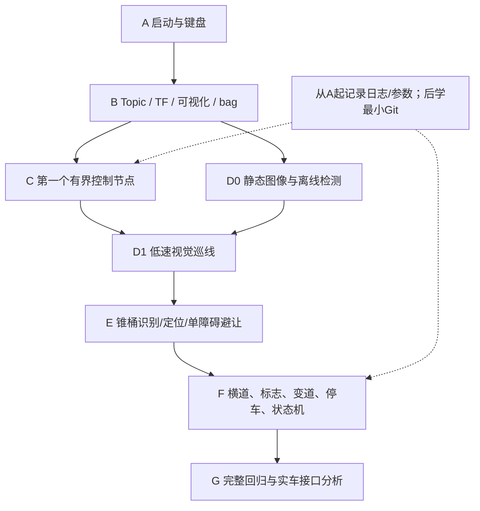

# 08 ChatGPT接手后的循序渐进路线

配置已于2026-10-15更新：前置30fps，速度/转角目标及反馈50Hz，drive.py定时50Hz，RSP上限50Hz；云台仍15fps。当前实测见 [频率修订报告](FREQUENCY_UPDATE_20261015.md)。未标修订的原始运行日志属于此前20Hz/15fps调查，不能当当前频率证据。

原则：每回合一个可观察的小实验，先目的/原理，再命令，最后让用户报告结果。先学工具与反馈，不把大段代码当教学。用户Linux/Python/C++基础尚未评估，节奏按反馈调整，不承诺固定几天完成。

## 依赖顺序

TF/CameraInfo、低速停车和录放是视觉/避障前置。基本实验记录从A就开始，Git基础在C前补上；不等到G才保存结果。实车迁移仍放最后。

## A 熟悉现有平台（不新增代码）

目标：认识当前车型、两个包、ROS消息如何使车运动；能独立开关并解释终端分工。

- A1：按05启动平坦场，只执行node list、一次odom echo。必要概念：Node、Topic、Message、反馈；观察车生成日志与静止odom。
- A2：低速键盘i/k，另一个终端观察cmd_vel和odom。解释命令速度与实际速度、阿克曼不能原地转、0.3s租约。通过：位姿确有小变化、停车后速度近0、可正常结束。
- A3：用已有drive.py发一次有时限的直行/小转角，解释m/s与rad，切换前确保键盘退出。通过：能预测转角符号，不把angular.z当方向盘角。
- 当前可复用：全部已有工具；预计增加：仅用户实验记录，不增加包。

**导师第一回合只教A1。**成功标准：用户提供节点列表、odom的frame/child_frame和坐标，以及说明车当前是否静止。若失败，先排查source/域/日志，等待反馈再继续。

## B ROS工具与可复现数据（不新增算法）

目标：看到数据来源、帧关系、实际频率，能录一个短实验再安全回放。

- B1：topic info/echo/hz；查看RELIABLE相机与BEST_EFFORT clock，观察发布者数。通过：分清topic存在、消息到达和频率。
- B2：rqt_image_view先看前相机再云台，确认rgb8、尺寸和各自CameraInfo；保存一帧观察白线/遮挡。通过：能指出当前640或1280模式。
- B3：RViz Fixed Frame=odom，加TF、RobotModel、Image、Odometry逐项验收，保存并重载配置。通过：无错误帧；能解释为何没有/scan。
- B4：rqt_graph与04图对应；rqt_plot画目标与实际速度；rqt_console找一次command_timeout。通过：能从命令追到执行和反馈。
- B5：先静止5秒bag，再录小段键盘运动；检查metadata，独立域只回放状态，使用单一clock。通过：读出topic/count，解释静止bag为什么不显示运动，不向在线车回放控制。
- 预计增加：用户自己的小bag、记录和RViz配置；不要立即引入数据库/容器/完整监控平台。

## C 第一个简单控制程序（到此才开始代码）

前置：会A/B，掌握最小Python函数/循环、读日志，了解Git基本提交。

- C1：先解释rclpy Node、Publisher、Timer与退出保护，设计一个限时低速控制节点，只选 `/ackermann_cmd`。明确输入配置、输出、50Hz定时发送、停止条件；让用户亲自实现小段代码，不一次生成完整工程。
- C2：订阅odom作记录，比较命令与响应；练习时间同步。通过：无人操作时有界结束，finally发零，异常仍能依赖插件租约停车。
- C3：只在平坦短段做“已知距离前进并停车”的简单闭环，解释位置/速度反馈与阈值，不用瞬移达成目标。通过：误差定义、单位正确、重复3次并记录，不能凭一次成功认定稳定。
- 预计新增：一个小型学习节点及参数/日志；是否新建教学包待用户与导师设计，当前不存在该包。只修改解释清楚且用户愿意亲自学习的文件。

## D 视觉巡线

前置：会图像/录放、相机坐标、误差符号和有界控制。

- D0：从已存PNG/短bag离线读一帧，解释RGB/BGR；画ROI与阈值结果，先人工检验白线而不发任何车辆命令。
- D1：分离左右白边、估计中心，记录像素误差；处理只看见一侧线的失败，区分黄胶带/横道。
- D2：解释当前K和TF，再选图像域误差或地面投影路径。先P，观察振荡/延迟，再讨论是否需要PID或Pure Pursuit；不是先套复杂框架。
- D3：低速短直道闭环→大弯道→红蓝背景与不同起点。通过：预先定义误差/压线/失线停车标准，录图与控制，至少多个重复实验。
- 预计新增：未来感知节点、单一跟踪节点、离线测试样例和参数文件；具体Topic/Message未定义。

## E 锥桶与避障

前置：巡线稳定、车体/轮胎包络、相机地面投影与最小转弯半径。

- E1：静止图像按红/蓝/黄分色，统计bbox与不同距离召回，先搞清楚黄色引导和单障碍的语义。
- E2：单目相对位置估计，使用Gazebo真值**只评分**，不让控制读取隐藏真值冒充感知。
- E3：手工已知目标位置的简单可行绕行轨迹→接入视觉→回到巡线，考虑车宽/转向速率与不压线。
- 通过：检测/定位误差可量化，保持最小净距、不碰锥桶、恢复车道；固定训练seed外，再选独立seed验证。
- 预计新增：未来目标定位、局部规划、跟踪参数与回归样例；不新增不存在的激光雷达作为捷径。

## F 剩余任务，拆开验收再组合

顺序建议：横道检测/停车→等待/语音→左右标志分类→单独变道归道→A/B分类→指定框低速停车→统一状态机。

每项先静态感知，再已知目标动作，最后连接；输入输出/触发/失败回退写成小表。横道等待秒数与跨线口径先确认规则；暂停实验要区分ROS计时和墙钟看门狗。

通过标准：误识别/重复触发有测试，左右/A/B混淆矩阵可读，停车用四轮接地判断，状态机能按顺序完成并有明确退出/超时。完整运行才统计完成率、碰撞/压线、耗时；当前工程尚无完整通关记录。

预计新增：未来任务协调、感知事件、语音适配、控制仲裁与集成日志。比赛区域2 QR不自动增加成未规定任务。

## G 工程化与实车迁移

完整仿真前已有最小Git、参数副本和实验记录；本阶段完善包分层、单元/集成回归、独立验证集、性能指标与技术手册。

先做软件接口清单：图像编码/K/TF/频率、速度/转角单位与时延、里程计真实性、驱动拓扑/传感器差异；实车相机固定安装与官方设备要求另外确认。新增独立硬件适配后端只能在明确授权后做，不能把Gazebo参数或PWM说明直接接到实体执行器。

通过：同一高层模块在已定义接口下可替换仿真/硬件；有标定、急停、超时和分阶段验证计划。先台架、小场低速，再扩展；不以仿真成功推断实车安全。

## 每次实验固定交付

1. 用户用自己的话说明目的和必要概念。
2. 记录环境/域/场景/seed、版本或hash、参数、命令。
3. 留可观察证据：节点/Topic、图、短bag、量化结果与错误日志。
4. 对照通过标准，失败先定位原因，成功也说明限制。
5. 复盘一个知识点，更新实验记录，再决定下一小步。
